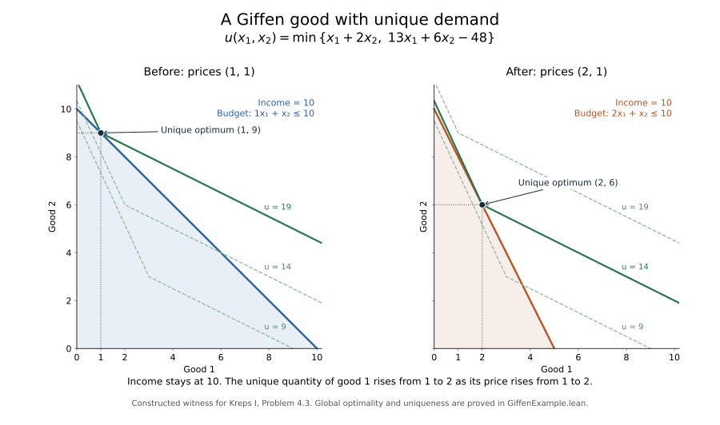

# Kreps Chapter 4: Revealed Preference and Afriat’s Theorem, in Lean

This is the independent `Volume1/RevealedPreference` proof project in Kreps Foundations.
It covers Chapter 4, pp. 67-78, including Problems 4.1-4.4.
[Return to the library index](../../README.md).

Status: the full frozen audit passed: **137 theorems and 192 declarations** across
17 modules, with all 14 verifier tests passing. Fresh elaboration and axiom-audit
records are maintained in [verification](verification/verification.json). The
[source map](docs/source-map.md) inventories every numbered result and mathematical
example. The [construction guide](docs/afriat-construction.md) traces the primitive
GARP-to-utility proof. [Corrections](docs/corrections.md) records the false unrestricted
finite own-price claim on p. 75 and its proved boundary counterexample.
Declarations use `Kreps.RevealedPreference`.

## Library map

| Module | Theorems | Contents |
| --- | ---: | --- |
| [Basic](RevealedPreference/Basic.lean) | 6 | Attributed rationality, strict preference, choice and utility prerequisites |
| [RevealedChains](RevealedPreference/RevealedChains.lean) | 11 | Weak and strict revealed chains, GARP and closing-edge criterion |
| [RevealedRanks](RevealedPreference/RevealedRanks.lean) | 7 | Cardinal rank construction and Lemma 4.4a–c |
| [AfriatRankInduction](RevealedPreference/AfriatRankInduction.lean) | 4 | Lowest-rank-class construction of positive Afriat coefficients; all-minimal case |
| [FiniteMinimum](RevealedPreference/FiniteMinimum.lean) | 6 | Problem 4.2: continuity, strict increase and concavity of finite minima |
| [FiniteAffineEnvelope](RevealedPreference/FiniteAffineEnvelope.lean) | 14 | Full-domain affine envelope, interpolation and budget maximum |
| [PreferenceProperties](RevealedPreference/PreferenceProperties.lean) | 5 | Attributed orthant, continuity, monotonicity, convexity and local insatiability |
| [MarketData](RevealedPreference/MarketData.lean) | 7 | Primitive original-income data, full budgets and exhaustion from GARP |
| [GarpNecessity](RevealedPreference/GarpNecessity.lean) | 5 | Lemma 4.1 and primitive rational-insatiable necessity of GARP |
| [AfriatTheorem](RevealedPreference/AfriatTheorem.lean) | 6 | All Afriat directions and full-domain regular utility construction |
| [ComparativeStatics](RevealedPreference/ComparativeStatics.lean) | 8 | Propositions 4.6–4.8: compensated effects and Giffen inferiority |
| [EconomicCommentary](RevealedPreference/EconomicCommentary.lean) | 8 | Direct rankings, strict convexity, WARP uniqueness and zero-income demand |
| [GiffenExample](RevealedPreference/GiffenExample.lean) | 18 | Problem 4.3: explicit regular utility and unique Giffen demand, with diagram |
| [MarketExamples](RevealedPreference/MarketExamples.lean) | 10 | Exact Tables 4.1–4.2, modified data, GARP decisions and Problem 4.1 |
| [InsatiabilityExamples](RevealedPreference/InsatiabilityExamples.lean) | 6 | Literal below-1000 plateau and locally insatiable boundary ties |
| [OwnPriceData](RevealedPreference/OwnPriceData.lean) | 7 | Own-price consistency and exact boundary counterexample to the p. 75 claim |
| [PrescribedUtilities](RevealedPreference/PrescribedUtilities.lean) | 9 | Full-domain utilities realizing both modified-example rankings |

The library contains 137 theorems across 17 modules and
192 audited named declarations, including definitions and generated structure
constants. Counts describe this source snapshot; they do not substitute for the
source-fidelity inventory.

## Main interfaces

- `proposition_4_3`: original-income GARP is equivalent to rational, locally
  insatiable preference maximization on all observed budget sets.
- `garp_exists_concave_utility`: actual continuous strictly increasing concave
  utility on all real commodity vectors, rationalizing the full nonnegative budgets.
- `lemma_4_5`: the book’s finite rank-class induction produces the Afriat coefficients.
- `problem_4_1`: the exact four-observation table admits a full regular rationalizer.
- `problem_4_3`: unique two-good demand rises from `(1,9)` to `(2,6)` when the first
  price rises from `1` to `2`, at fixed income `10`.



The diagram is generated by `scripts/plot_giffen_example.py`; the corresponding
full-domain utility, global optimality and uniqueness are proved independently in Lean.

## Build and verify

Use the committed Lean `v4.34.0` toolchain and Mathlib `v4.34.0` dependency lock.
From this directory:

```sh
lake build
python -m unittest discover -s scripts -p 'test_*.py' -v
python scripts/verify.py
```

The unchanged verifier freshly elaborates the full source and audits transitive
axioms of every named declaration. Only `propext`, `Classical.choice` and `Quot.sound`
are permitted. Local prerequisite copies retain attribution; this project does
not depend on another chapter’s Lake project. See [CONTRIBUTING](CONTRIBUTING.md)
and [THIRD_PARTY_NOTICES](THIRD_PARTY_NOTICES.md).
